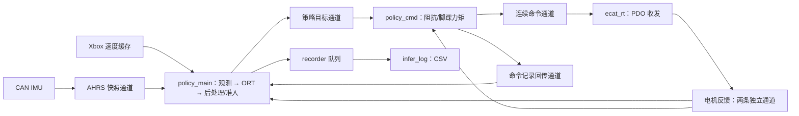

# policy_test 完整运行的函数调用链与数据链

本文依据当前工作区代码，按 `policy_test` 成功启动、持续运行策略、最后退出的路径
梳理。当前默认配置是 Xsens CAN IMU、12 电机阻抗控制、675 维观测、ORT CPU
单线程。这里的运行顺序来自源码分析，没有启动真实电机；没有修改生产代码。

最关键的线程关系：`policy_main` 内同步执行观测和 ORT；`policy_cmd` 消费模型
关节目标，结合更新的反馈计算电机命令；`ecat_rt` 消费命令并收发 PDO。三者按各自
周期运行，没有每帧互相等待的同步屏障。日志通过命令线程回传，由策略线程入队，
最后在后台线程写盘。

| 线程 | 当前配置 | 职责 |
| --- | --- | --- |
| `policy_main` | CPU4，SCHED_OTHER，策略周期 20 ms | 主程序、观测构建、ORT 推理、结果准入和日志入队 |
| `imu_can_rx` | CPU2，SCHED_OTHER，按 CAN 到达事件运行 | 接收/解析 IMU，发布 AHRS 快照 |
| `policy_cmd` | CPU6，FIFO70，1 ms | 消费目标、读取反馈、计算脚踝力矩及阻抗命令 |
| `ecat_rt` | CPU7，FIFO80，1 ms | 命令/STOP 状态机、EtherCAT PDO 收发、反馈发布 |
| `xbox_poll` | CPU0–1，SCHED_OTHER | 设备事件读取和速度缓存；20 ms 参数是 poll 等待超时 |
| `infer_log` | CPU0–1，SCHED_OTHER | CSV 写入，默认每 1 s 或退出时 flush |
| `motor_status` / `rt_event` | CPU0–1，SCHED_OTHER | 公共状态发布和实时事件转发；电机 controller.start 中启动 |

当前电机打印关闭，因此不启动额外的 `motor_mon` 打印线程。后台公共状态线程与
策略/命令使用的两条直接反馈通道分别承担不同的消费职责。

默认 intra-op=1，因此推理就在 `policy_main` 中完成。CPU5 为双线程实验预留，
默认不创建额外 ORT intra-op worker。线程配置入口见
[robot_config.hpp](../src/inference/include/robot/robot_config.hpp:150)。



**1. 进程启动与一次性配置**

入口为 [policy_test.cpp 的 main](../src/inference/examples/policy_test.cpp:78)。

```text
main
 ├─ signal(SIGINT/SIGTERM, signal_handler)
 ├─ load_deploy_config(argv[1] 或编译期默认 YAML 路径, cfg, error)
 │   └─ DeployConfigLoader::load
 │       ├─ YAML::LoadFile
 │       ├─ RobotInterfaceConfig{}：建立代码默认值，解析模型/日志默认路径
 │       ├─ load_joint_topology
 │       ├─ require_finite_positive(step_dt)
 │       ├─ load_motor_gains / load_default_joint_pos
 │       ├─ load_commands / load_action / load_observations
 │       └─ 配置类型、数组维度、映射、范围及训练 schema 校验
 ├─ make_rk3588_runtime_profile() → 覆盖 cfg.runtime
 ├─ 关闭电机状态打印
 ├─ environment_check
 ├─ configure_current_thread("policy_main", cfg.runtime.policy_main)
 ├─ XboxController::open_device
 ├─ RobotInterface robot(cfg)
 ├─ RobotInterface::initialize
 └─ XboxController::start_polling(20 ms, cfg.runtime.background)
```

配置来源必须区分：当前 YAML 提供 joint_ids_map、周期、增益、默认姿态、动作
scale/clip 和各观测 scale/history。IMU 类型与设备、传感器年龄、超时、模型路径、
日志开关等来自 C++ 默认配置，线程布局由 `main` 显式覆盖。模型与日志默认相对
路径以编译期 `src/inference` 根目录解析，不随程序启动工作目录变化。

当前 [deploy.yaml](../src/inference/config/deploy.yaml:1) 对应：

- `step_dt=0.02 s`，每个观测字段历史长度 15，未启用 gait_phase。
- 模型默认 `model/policy.onnx`，实际端口为 `obs float32[1,675] → actions float32[1,12]`。
- 增益先按模型顺序读取，再通过 joint_ids_map 转成物理电机顺序。
- 四个脚踝电机增益还写入虚拟关节 PD：本配置为 kp=50、kd=3，覆盖结构体中的默认值。
- YAML 的 commands.ranges 当前承担 schema/范围校验；Xbox 映射使用自身常量。
  当前 vx 范围 ±1 m/s、yaw_rate 范围 ±0.6 rad/s，`main` 明确传入 vy=0。

**2. RobotInterface 初始化与进入首帧之前的保持**

见 [RobotInterface::initialize](../src/inference/src/robot/robot_interface.cpp:42)。

```text
initialize
 ├─ initialize_model_processors
 │   ├─ JointMapping::create → configure
 │   ├─ ActionProcessor 构造：IK/FK 状态、滤波系数和运行态初始化
 │   └─ ObservationBuilder 构造：历史全零、last_action 全零、frame_index=0
 ├─ PolicyRuntime::load
 │   ├─ 检查 .onnx 路径、线程配置和主线程亲和性
 │   ├─ 创建 Env/Session，CPU EP，顺序执行、完整图优化、关闭 spinning
 │   ├─ 读取实际输入输出节点名，检查数量/float32/形状
 │   ├─ 创建固定输入输出缓冲区与 Ort::Value
 │   └─ warm_up：20 次零输入 Run，检查输出有限性
 ├─ mlockall(MCL_CURRENT | MCL_FUTURE | MCL_ONFAULT)
 ├─ prefault_current_thread_stack
 ├─ InferenceRecorder::start → 创建 CSV/写表头/启动 infer_log
 ├─ RobotMotorSession::initialize(defer_communication_protection=true)
 │   ├─ 创建 EthercatAdapterIGH / MyActMotorController
 │   ├─ connect → wait_all_motors_ready → start（启动 ecat_rt）
 │   ├─ stop：请求 STOP 并等待确认
 │   └─ submit_command(set_mode)：提交各轴模式配置
 ├─ RobotMotorSession::restart(-1)：等待各轴 control_ready
 ├─ 等待 500 ms
 ├─ RobotImuSession::initialize → XsensMtiCanReader::start → imu_can_rx
 ├─ 等待 1 s
 ├─ reset_joints
 │   ├─ get_motor_snapshot
 │   ├─ ActionProcessor::build_reset_start_model_pose：直驱映射 + 脚踝 FK
 │   ├─ 100 步模型关节角插值到默认姿态
 │   ├─ ActionProcessor::build_motor_targets：直驱映射 + 脚踝 IK/限位
 │   └─ apply_targets_rad：逐步提交电机目标，默认步间 sleep 5 ms
 └─ PolicyCommandWorker::start
     ├─ 再提交一次最终复位姿态
     └─ start_configured_thread("policy_cmd", ...) → loop
```

预热和模型初始化早于电机启动。预热不会推进观测历史、策略帧号或首帧截止期。
进入正式推理前，worker 每 1 ms 刷新最终复位姿态；第一次正式推理启动后，首帧
目标期限被封顶为“首次推理启动时间 + 60 ms”。启动/复位期间仅延后指定通信
保护的终端锁存，实际通信状态和其他故障检查仍存在。

**3. 传感器与速度指令的数据采集**

IMU 分支见 [XsensMtiCanReader::read_loop](../src/imu/src/drivers/xsens_mti/xsens_reader.cpp:58)：

```text
CAN 帧
 → SocketCanPort::wait_readable / read_nonblocking（recvmsg）
 → XsensMtiCanParser::feed
 → parse_sample_time / parse_quaternion / parse_rate_of_turn
 → update_orientation_from_quaternion：欧拉角和 projected_gravity
 → publish_ahrs_if_ready：四元数、角速度都已更新后发布
 → RobotImuSession 注册的 AHRS callback
 → AhrsStateSnapshot → ahrs_state_channel_.publish
 → policy_main 中 get_ahrs_snapshot 消费最新值，没有新帧时沿用缓存
```

`AHRSData` 中角速度等是 float，session 转为 double 快照；扩大类型不会恢复已损失
的精度。`sample_timestamp_ns` 是设备时钟数据；`receive_timestamp_ns` 使用内核
接收时间映射到主机 monotonic 时钟。合成 AHRS 的接收时间取四元数和角速度两者
中较早者，策略时效判断用接收时间。欧拉角保留在快照中，策略观测直接使用角速度
和重力投影，不把欧拉角拼进模型输入。

电机分支见 [realtime_cycle_callback](../src/motors/src/drivers/myact/myact_motor_controller.cpp:312)：

```text
ecat_rt
 → EthercatAdapterIGH::receive_physical
     → ecrt_master_receive / ecrt_domain_process
 → MyActMotorController::update
     → adapter.receive：PDO 中的 pos/vel/torque/status 等
     → 转为 rad、rad/s、torque_percent
     → 完整有效 PDO 才更新各电机 last_valid_host_timestamp_ns
 → send_physical 后 update_realtime_feedback
     → array<MotorStatusSnapshot,12>
     → MotorControllerBase::publish_feedback
        ├─ policy_feedback_channel_ → RobotMotorSession::get_motor_snapshot
        ├─ command_feedback_channel_ → policy_cmd 独立消费
        └─ 公共状态缓存
```

策略取得的 `MotorStateSnapshot` 是物理电机顺序的 double[12] 位置/速度/扭矩和
uint8[12] 通信/使能标志。其时间戳取 12 个电机有效时间的最小值；没有新反馈时
沿用缓存，年龄仍继续增长。策略与命令线程各消费一条反馈通道，互不抢读。

Xbox 分支为 `polling_loop → read_available_events → process_abs_event →
refresh_command_locked → map_axes`，在互斥锁保护下更新 `VelocityCommand`；
`main` 通过 `latest_command` 取最近值，再调用
`set_target_velocity(command.vx, 0.0, command.yaw_rate)`。

IMU 和电机是独立的最新值源，策略读取后各形成一份固定快照；没有硬件同时采样
或跨设备配对屏障，快照在本轮推理期间不再被后台线程改写。

**4. 一次 policy_step 的函数链**

见 [policy_step](../src/inference/src/robot/robot_interface.cpp:364)。

```text
main 的 20 ms 循环
 ├─ latest_command → set_target_velocity
 └─ RobotInterface::policy_step
     ├─ worker.healthy / policy_runtime.is_loaded / motor_session.is_initialized
     ├─ motor_session.get_motor_snapshot
     ├─ imu_session.get_ahrs_snapshot
     ├─ validate_policy_sensor_timing
     │   └─ 时间戳有效；当前 IMU 年龄不大于 50 ms、电机年龄不大于 20 ms
     ├─ observation_time_ns = min(电机时间, IMU 接收时间)
     ├─ ObservationBuilder::build
     │   ├─ 源数值有限性与重力有效性检查
     │   ├─ fill_joint_terms → fill_ankle_fk_joint_terms → FK / Jacobian
     │   └─ update_term_history → PolicyObservation
     ├─ enable_communication_protection
     ├─ 首次推理时间标记；policy_seq = frame_index + 1
     ├─ PolicyRuntime::infer → Session::Run
     ├─ 再次 worker.healthy
     ├─ policy_step 内部逐关节裁剪/缩放/偏移 → target_q_model_rad
     ├─ admit_policy_result：最老观测到此时年龄大于 40 ms 则丢弃
     ├─ 准入：填 target 写槽 → publish_target → commit_policy_action
     ├─ advance_frame：包括丢弃结果的帧
     ├─ record_completed_policy_frame：消费命令线程回传记录并入 recorder 队列
     └─ 丢弃：直接记录该次推理，但不发布目标、不提交 raw action
```

`main` 使用 `sleep_until(next_tick)`；超过后续一个完整策略周期时重置下一次调度
基准。`policy_cmd` 有自己的 1 ms `sleep_until`，`ecat_rt` 使用 monotonic 绝对时间
`clock_nanosleep`，所以 50 Hz 策略目标与 1 kHz 命令不是逐帧一对一调用。

**5. 观测帧：字段、顺序、历史与单位**

见 [ObservationBuilder::build](../src/inference/src/robot/observation_builder.cpp:122)。
固定容量 `PolicyObservation = array<float,705>`，当前实际使用前 675 个元素。
每种字段独立保留 15 帧，字段内部按旧到新排列；不是将 15 个完整 45 维帧简单串接。

| 字段 | 每帧维度 | 当前 675 模式的零起始索引 | 当前计算 |
| --- | ---: | --- | --- |
| base_ang_vel | 3 | 0–44 | 机体角速度 rad/s × 0.2，转 float |
| projected_gravity | 3 | 45–89 | 四元数计算的重力方向投影，直接转 float |
| velocity_commands | 3 | 90–134 | `[vx,0,yaw_rate]` × `[1,1,1]`，转 float |
| joint_pos_rel | 12 | 135–314 | `(q_model − default_q_model)` × position scale，当前 scale=1 |
| joint_vel_rel | 12 | 315–494 | `dq_model × 0.05` |
| last_action | 12 | 495–674 | 上一次准入并发布的 raw action，裁剪到 `[-1,1]` |

当前没有额外均值/方差归一化；观测配置的 clip 为 null。直驱关节先按 mapping 和
电机方向变换到模型顺序；脚踝先将物理电机角度映射为虚拟 pitch/roll（FK），再用
`dq_virtual = J × dq_motor` 得到虚拟关节速度。

第一次 build 使用当前字段值填满对应的全部 15 帧，last_action 为全零；以后每次
build 移出最旧值并追加当前值。原始策略结果只有在发布成功后才更新 last_action，
它保存无量纲动作，不保存缩放后的关节目标或最终电机命令。

若配置启用 gait_phase，会在 command 历史之后插入 2×15=30 个元素；后续三个字段
起点依次变为 165、345、525，总维度 705，需要匹配的模型。当前运行不走此分支。

**6. 模型推理与输出处理的数据链**

见 [PolicyRuntime::infer](../src/inference/src/policy/policy_runtime.cpp:355)。

```text
PolicyObservation（float[705]，前 675 有效）
 → 有效输入有限性检查
 → 拷贝前 675 个元素到持久 input_buffer
 → input_tensor：float32[1,675]，节点名 obs
 → Ort::Session::Run（初始化时已加载的同一会话）
 → output_tensor / output_buffer：float32[1,12]，节点名 actions
 → PolicyRuntimeStepResult.raw_action（float[12]）和推理起止 monotonic 时间戳
 → 检查输出有限性
 → RobotInterface::policy_step 中转 double、裁剪、缩放
 → target_q_model_rad（double[12]，模型关节顺序，单位 rad）
```

对每个模型 DOF，当前计算为：

```text
a_i       = clamp(double(raw_action_i), -1, 1)
offset_i  = clamp(a_i × action_scale_i, action_clip_i.lower, action_clip_i.upper)
q_target_i = default_joint_pos_i + offset_i
```

这是 `policy_step` 内的直接计算，代码中没有另一个“策略输出后处理函数”。raw
action 的历史裁剪与这里的目标生成是两条用途不同的数据处理路径。

`publish_target` 将模型目标、policy_seq、相关记录发布到 `target_channel_`。
`PolicyTargetFrame` 包含发布时间和 `InferenceRecord`；即使禁用日志，控制字段也
借用 record 中的 policy_seq、target_q_model_rad 和 policy_valid_until_ns。
本次发布时设置 `policy_valid_until_ns = published_at_ns + 60 ms`。

**7. 策略目标到电机模块：模型顺序转为物理顺序**

见 [PolicyCommandWorker::loop](../src/inference/src/robot/policy_command_worker.cpp:164)。

```text
target_channel_.try_consume_latest → 保留最新的 PolicyTargetFrame
 → 检查策略目标是否到期
 → RobotMotorSession::try_consume_latest_status_command → 独立电机反馈缓存
 → 检查最老反馈时间
 → ActionProcessor::build_policy_impedance_command
    ├─ 检查 12 电机反馈有效性、control_ready 和脚踝实际位置限位
    ├─ 8 个直驱 DOF：模型目标 → 电机索引/方向 → ImpedanceSetpoint
    └─ 左右脚踝分别 apply_ankle_torque_control
       ├─ FK：上下电机角 → 当前虚拟 pitch/roll
       ├─ Jacobian：上下电机速度 → 虚拟 pitch/roll 速度
       ├─ 虚拟关节 PD → 二阶低通
       ├─ tau_motor = J^T × tau_virtual
       └─ 电机方向 × 1000/额定力矩 → effort_ff 千分比，限幅
 → 再次检查目标/反馈时效
 → policy_command_timing
 → RobotMotorSession::apply_impedance_setpoints_realtime
 → ControlCommand::set_impedance_targets_fixed
 → MotorControllerBase::send_policy_setpoint
 → setpoint_channel_policy_.publish
```

当前直驱模型索引 0…7 对应物理电机 `[0,6,1,7,2,8,3,9]`；物理电机方向为
`[-1,-1,+1,+1,-1,-1,-1,+1,+1,-1,-1,-1]`。左脚踝虚拟 `(pitch=8,roll=10)`
由 M4/M5 控制，右脚踝 `(pitch=9,roll=11)` 由 M10/M11 控制。

正式策略输出的四个脚踝 DOF 是虚拟关节目标，不是四个电机的直接位置目标。
IK 用于初始化复位；正式 worker 中使用上述反馈 FK/Jacobian 力矩路径。

| 最终阻抗 setpoint | 8 个直驱电机 | 4 个脚踝电机 |
| --- | --- | --- |
| position_rad | 方向修正后的模型关节目标 | 该次反馈中的物理电机位置 |
| velocity_rad_s | 0 | 0 |
| effort_ff | 0 | 计算出的电机力矩千分比，当前限制 ±2000 |
| kp / kd | YAML 映射后的电机增益 | 0 / 0，虚拟关节 PD 已在上层计算 |

`FixedPolicyMotorCommand` 为固定容量的 12 个 setpoint，顺序已变成物理电机顺序。
一个策略目标可被 worker 使用多次；期间反馈更新，脚踝力矩和滤波状态也持续更新。

命令时序元数据为：

```text
source_policy_seq = 当前目标的 policy_seq
produced_at_ns    = 本次 worker 计算完命令后的时间
valid_until_ns    = min(策略目标发布时间+60 ms,
                        produced_at_ns+10 ms,
                        最老电机反馈时间+20 ms)
```

重复发送命令仅刷新独立命令期限，不能延长策略目标的 60 ms 期限。

**8. 电机模块如何接收命令并发送 PDO**

见 [MotorControllerBase::thread_func](../src/motors/src/motor_base/motor_controller_base.cpp:187)。

```text
ecat_rt 每 1 ms
 ├─ service_stop_requests(true)
 ├─ process_queued_commands / service_discrete_commands
 ├─ process_latest_setpoint_commands
 │   ├─ 先检查现有命令的 freshness 和终端故障
 │   ├─ setpoint_channel_policy_.try_consume_latest
 │   ├─ validate_setpoint_timing
 │   └─ MyActMotorController::apply_setpoint_command_impl
 │       └─ 校验 mode/control_ready → _motors[i].desired.impedance_setpoint
 ├─ service_stop_requests(false)
 └─ MyActMotorController::realtime_cycle_callback
     ├─ receive_physical：接收并处理本周期 PDO
     ├─ update：更新反馈、故障/通信状态机
     │   ├─ process_single_motor：将 desired 转为 TxPDO
     │   └─ adapter.send：写 tx_shadow
     ├─ send_physical：写过程数据区 → ecrt_domain_queue → ecrt_master_send
     └─ update_realtime_feedback → publish_feedback
```

控制模式为 IMPEDANCE，对应驱动 PVT。位置/速度从 rad/rad/s 转换成驱动计数；
普通电机每转位置计数为 131072，脚踝为 262144；effort_ff 四舍五入为 int16，
kp/kd 乘 1000 转整型。接收方向相反：PDO 计数转物理单位，反馈扭矩 raw×0.1
得到 torque_percent。最终 PDO 发送以 ecat_rt 调度为准。

`send_policy_setpoint` 返回 ACCEPTED 只表示通过提交校验并发布到命令通道；RT
线程仍会进行到期/控制就绪校验。普通连续 setpoint 走最新值通道；模式切换、
RESTART 走离散命令机制；STOP 使用专门请求机制绕过普通队列。

**9. 日志数据在哪一刻形成，如何写入 CSV**

见 [policy_step 的 fill_log_record](../src/inference/src/robot/robot_interface.cpp:463)、
[worker 的记录回传](../src/inference/src/robot/policy_command_worker.cpp:286) 和
[InferenceRecorder::worker_loop](../src/inference/src/recorder/inference_recorder.cpp:328)。

```text
policy_main：准入判断后
  → fill_log_record：该次策略的传感器快照、观测、raw action、模型关节目标、时间/年龄
  → 随 PolicyTargetFrame 发布

policy_cmd：某 policy_seq 首次成功提交连续命令后
  → 复制该记录，追加 command_timestamp_ns / command_valid_until_ns
  → command_applied=true
  → 填物理电机 target_pos_rad / target_effort_permille
  → completed_record_channel_.publish_written

policy_main：同轮末尾或后续轮次/停机收尾
  → record_completed_policy_frame → try_consume_completed_record
  → record_policy_frame → InferenceRecorder::try_record
  → mutex 保护下的 deque（默认上限 4096）→ condition_.notify_one

infer_log
  → worker_loop：wait_until → 取走本批记录
  → write_record → CSV
  → 默认 1 s 或 stop 时 flush，退出前排空已取到的记录
```

因此可以在命令发送前组装日志字段，但完整命令记录要等命令线程提交后才形成；
CSV 文件 I/O 在后台进行。`command_applied=true` 对应向电机模块提交成功，不能
用它证明 PDO 已发送或驱动器已执行。`rx_pos_rad` 等记录的是策略输入的反馈快照；
worker 算脚踝力矩时可能已经使用了更新的反馈。日志中的脚踝 target_pos_rad 是
物理反馈位置，虚拟关节目标要看 target_q_model_rad。

对丢弃的策略结果，策略线程直接入日志队列，不发布目标；command_applied 保持
false。目标与完成记录通道都是 latest-value，未读取旧帧可被覆盖；同一目标也只
回传一次记录，因此 CSV 不是 1 kHz 的逐命令执行流水。recorder 队列满时丢最旧
记录并计数；运行中日志入队失败会报告并停止后续入队，不直接改变控制目标。

**10. 首帧到后续帧，以及最终退出**

| 时刻 | 数据/状态变化 |
| --- | --- |
| 模型预热 | 零输入 Run 20 次；观测历史和正式帧号不推进 |
| 首次正式 build | frame_index=0，15 帧均由当前字段填充，last_action 为零 |
| 首次 infer | policy_seq=1，记录首次推理启动时间，worker 首帧目标截止期开始生效 |
| 结果准入并发布 | 采样 published_at_ns，设置目标截止期，提交裁剪后的历史动作 |
| worker 多次循环 | 每次结合最新反馈生成一条连续命令；同一 seq 最多回传一次日志 |
| 下一轮策略 | frame_index=1，追加新观测，last_action 来自上一已发布结果 |
| 单次结果被丢弃 | 不刷新目标期限、不更新 last_action；帧计数和观测历史继续推进 |
| 长时间无新目标/命令 | worker/RT 的独立期限保护触发，不能靠重复下发无限保持 |

正常 Ctrl+C/SIGTERM：`signal_handler` 置位退出标志，`main` 跳出循环后
`safe_shutdown → RobotInterface::shutdown`。先请求电机 STOP、请求 worker 退出，
等待 STOP 确认；随后 join worker、收取最后完成记录、释放 ORT、停止并排空 recorder、
重置状态、停止 IMU、释放电机控制器，最后停止 Xbox polling。

策略错误走 `handle_policy_step_failure`，worker 错误走 `fail`，二者均先请求电机
停止再处理诊断。STOP 未确认且不满足持续通信丢失释放条件时返回 RetryRequired，
保留 RT；析构继续重试。ReleasedAfterCommLoss 表示已释放资源但未宣称 STOP 得到确认。

**11. 主要数据结构一览**

| 边界 | 数据结构 | 顺序/类型 | 生产者 → 消费者 |
| --- | --- | --- | --- |
| 配置 → 运行对象 | RobotInterfaceConfig | 模型参数与物理电机增益分开保存 | main → 各 session/processor/runtime |
| CAN → AHRS 快照 | AhrsStateSnapshot | double[3] 角速度/重力/欧拉角，两个时钟来源的时间戳 | imu_can_rx → policy_main |
| PDO → 电机反馈 | array<MotorStatusSnapshot,12> | 物理电机顺序，rad/rad/s/扭矩百分比/状态 | ecat_rt → policy_main 与 policy_cmd 各一条通道 |
| 反馈汇总 → 观测 | MotorStateSnapshot | 物理电机 double[12]，最老有效主机时间 | policy_main 内部 |
| 观测 → ORT | PolicyObservation | float[705] 容量，当前使用 675；字段历史展平 | policy_main 内部 |
| ORT → 后处理 | PolicyRuntimeStepResult | 模型顺序 float[12] 动作 + 推理起止 ns | policy_main 内部 |
| 策略 → 命令计算 | PolicyTargetFrame | 模型顺序 double[12] 目标 + seq/期限/记录 | policy_main → policy_cmd |
| 命令计算 → 电机模块 | FixedPolicyMotorCommand → ControlCommand | 物理顺序 12 个阻抗 setpoint + CommandTiming | policy_cmd → ecat_rt |
| 电机模块 → 总线 | TxPDO | 位置/速度/扭矩/增益的协议整数 | ecat_rt → EtherCAT 从站 |
| 命令计算 → 记录汇合 | InferenceRecord | 输入观测与输出、物理目标、时间和年龄 | policy_cmd → policy_main |
| 记录汇合 → 文件 | InferenceRecord deque → CSV | ns 主时间戳；duration/age 列为 us | policy_main → infer_log |
